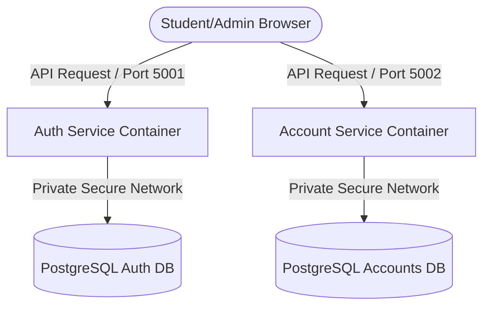

# 🏫 School Account 

## 📝 Project Overview
The **School Account ** houses the decoupled backend microservices designed for robust, secure, and scalable school financial management and administrative operations. By isolating specific domains into separate services, this architecture ensures high operational efficiency, independent scalability, and secure management of sensitive institutional data.

---

## 🏗️ Architecture Overview
This repository implements a production-grade, decoupled microservice pattern with independent backend engines talking directly to isolated data layers without relying on an external Ingress controller wrapper.



### Core Architecture Components:
*   **Auth Service (`auth-service`):** Manages user credentials, administrative verification sessions, and security token delivery. It connects via an isolated internal network layer to a dedicated PostgreSQL database container tracking authentication records.
*   **Account Service (`account-service`):** Handles institutional ledgers, billing transactions, fee records, invoices, and payment tracking. It connects independently to its own distinct PostgreSQL storage layer to protect transactional data.

---

## 💻 Tech Stack & Components
The ecosystem is architected using distinct, robust technologies specialized for system resilience:
*   **Backend Framework:** Python 3.12 with **Flask API**
*   **Production Gateways:** **Gunicorn** (WSGI process multiplexer optimized for concurrent request handling based on available CPU cores)
*   **Database Tier:** Isolated **PostgreSQL 15+** database containers running on default port `5432`
*   **Database Connectivity:** Powered by `psycopg2-binary` engine drivers

---

## ⚙️ Pattern Implementation & Deployment Strategy

### Configuration & Secret Management Pattern
To enforce strong security boundaries and environment separation, all specific system configurations are completely externalized from the code logic:
*   **ConfigMaps Configuration:** Drives non-sensitive environmental properties (`DB_HOST`, `DB_PORT`, `DB_NAME`, `DB_USER`).
*   **Secrets Configuration:** Injects sensitive infrastructure variables (`DB_PASSWORD`) securely at execution runtime into the environment, preventing credential leaks inside code repositories.

### Storage Persistence Pattern
Since runtime containers are naturally ephemeral, data safety is guaranteed through a **Persistent Volume Claim (PVC)** strategy. The PostgreSQL engines are assigned physical cloud storage blocks via automated storage allocations, ensuring school portal files, accounting balances, and ledger sheets survive unexpected pod crashes or rolling system updates.

### 🛡️ Automated CI/CD Pipeline & Security Lifecycle
The repository implements a secure-by-design **GitHub Actions CI/CD Pipeline** that subjects all pull requests and commits merging into the `main` branch to a strict multi-layered automated security gate before delivery:

```text
[Code Push] ──> [Secret Scan] ──> [Dependency Scan] ──> [IaC Scan] ──> [Build] ──> [Container Scan] ──> [Registry Push]
```

1.  **Secret Detection Scanning:** The pipeline runs static scanning utilities (such as *TruffleHog* or *GitGuardian*) across the commit history to ensure no plain-text database credentials, deployment passwords, or API keys are accidentally committed to Git.
2.  **Software Composition Analysis (SCA / Dependency Scan):** Automating vulnerability audits (such as *Snyk* or *GitHub Dependabot*) against the `requirements.txt` manifests to block the build if any of the pinned library frameworks contain known exploits.
3.  **Infrastructure as Code (IaC) Scanning:** Static analysis scanning (such as *Checkov* or *Trivy*) intercepts our Kubernetes manifest configurations and Dockerfiles to discover cloud misconfigurations, such as running containers as `root` users or mapping insecure network privileges.
4.  **Static Application Security Testing (SAST):** Executes linting and security evaluation passes over raw Python source tracks to catch common development vulnerabilities (e.g., SQL injection loopholes or insecure error handles).
5.  **Container Image Vulnerability Scanning:** Once our multi-stage Docker build finishes packaging the app layers, the resulting image is systematically scanned (using *Aqua Security Trivy* or *Anchore*) to catch vulnerabilities hidden inside the baseline Linux operating system layers (`python:3.12-slim`) before it is cleared for container registry storage pushing.

### Zero-Downtime Deployment Strategy
To guarantee the account portal remains 100% accessible during application updates, the cluster uses a strict **Rolling Update Strategy**:
*   **Incremental Rollout:** Kubernetes spins up a new version container (Pod v2) alongside the running older version (Pod v1).
*   **Readiness Probes:** The internal service layer blocks application traffic from hitting the new container until its internal application environment passes automated health diagnostics checks.
*   **Graceful Termination:** Once confirmed healthy, traffic seamlessly transitions to Pod v2. The older Pod v1 finishes handling its current active web sessions before gracefully shutting down.
